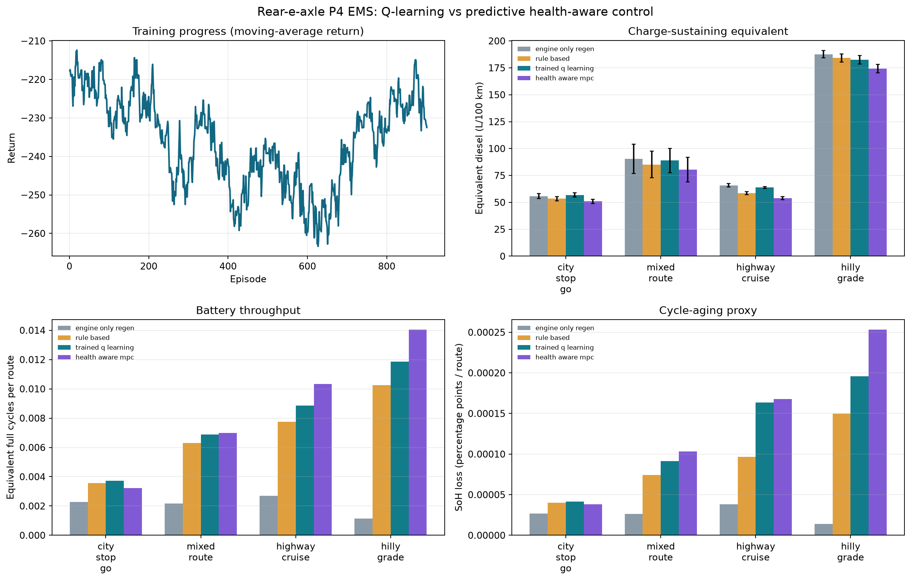
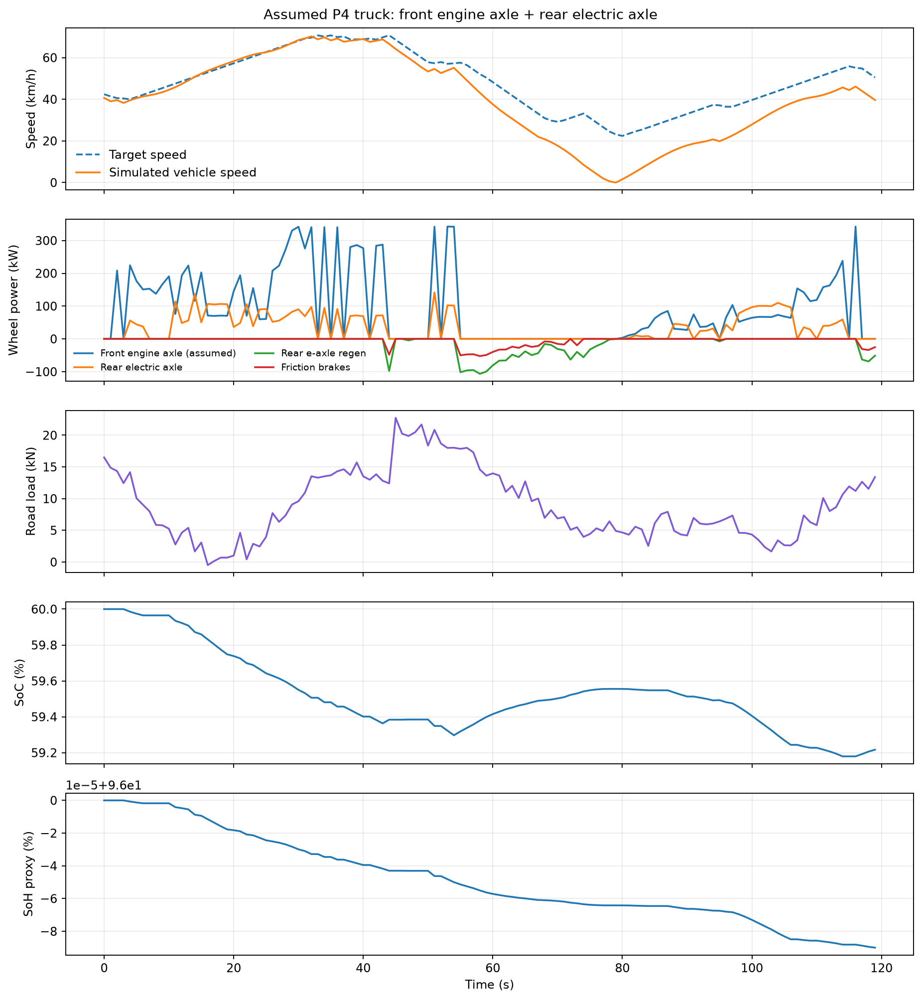

# Efficient and Sustainable Multi-Agent EMS for a Heavy-Duty Hybrid Truck

This project studies a multi-agent energy management strategy for a heavy-duty hybrid truck. The design is inspired by the electrification work associated with a heavy-vehicle context, with the goal of managing engine and motor power so that the truck remains efficient and safe across realistic operating conditions.

The system is organized around a layered control architecture in which a supervisory planner interprets the mission, the powertrain policy manages engine and motor torque split, the battery-health controller constrains charge and discharge, and the performance layer evaluates energy use, thermal stress, regenerative recovery, and long-term sustainability. The workflow is intentionally modular so it can be extended toward stronger RL or MPC-based optimization without sacrificing transparency or explainability.

## 1. Research framing

Heavy-duty hybrid trucks operate under very different constraints from passenger vehicles. Long mission durations, variable road grade, high transient torque demands, and the cost of battery degradation mean that energy management must balance efficiency, durability, thermal safety, and driver comfort in a coordinated way.

This repository proposes a multi-agent control structure designed for that challenge. Rather than relying on a single rule set, the decision problem is divided into specialized agents that work toward a common objective. That structure makes the project more suitable for research communication, benchmarking, and further extension toward policy optimization.

## 2. Control architecture

The system is composed of the following layers:

- Mission and safety supervisor: defines strategic objectives, safe SoC boundaries, and regenerative priorities.
- Powertrain coordination policy: allocates engine torque and motor support while respecting efficiency and driver demand.
- Battery health and thermal protection: limits charging and discharging under degradation and temperature constraints.
- Driver-assistance layer: translates the final decision into smooth and understandable guidance for the operator.
- Performance and benchmark layer: evaluates reward, thermal safety, fuel efficiency, and sustainability across missions.

This layered logic keeps the controller readable while preserving a realistic multi-agent structure.

## 3. Trained RL prototype

The repository includes reproducible **Double Q-learning** in `src/multi_agent_ai/rl_training.py`. This is distinct from `DeepRLEMSPolicy`, which remains a legacy hand-coded heuristic and is **not** a learned model. Double Q-learning maintains two estimators and updates one using the other, reducing the maximization bias of ordinary tabular Q-learning; it is still a small discrete controller, not a claim that RL is sufficient for deployment. The learned table selects bounded motor-assist/regen and electric-axle gear actions; the driver-selected truck gear is not an EMS action.

The plant represents the requested **two-axle P4 arrangement with the electric axle at the rear**. Rear e-axle placement comes from the user; the other/front engine-driven axle is currently an explicit layout assumption pending Sisu drawings. It integrates speed using longitudinal force balance, with separate engine/front-axle and rear-e-axle forces; braking blends rear-axle regeneration with friction brakes subject to battery limits.

Training randomizes initial SoC, SoH, battery temperature, ambient conditions, and four duty-cycle families. Battery SoH is part of the observation. The health output reports equivalent full cycles, cycle-fade proxy, calendar-fade proxy, peak temperature, and time above 35 °C; these are screening indicators, not chemistry-specific remaining-useful-life predictions. The held-out suite compares Double Q-learning with a five-second health-costed receding-horizon MPC, a rule baseline, and engine-only propulsion with rear regen. **Vehicle values and fade coefficients remain assumptions, not verified Sisu specifications or calibrated cell/pack data.** See [P4 model, aging proxy, controller method, and caveats](docs/P4_VEHICLE_MODEL.md).

### Train and reproduce

```powershell
python -m pip install -e . pytest
python -m pytest -q
python -m multi_agent_ai.rl_training --episodes 1000 --seed 2026
```

The package entry point runs the same P4 training workflow: `python -m multi_agent_ai.main --episodes 1000 --seed 2026`.

The run saves the portable model, metadata, training history, per-episode benchmark results, summary, and plot under `artifacts/`. Use `python -m multi_agent_ai.rl_training --evaluate-only` to re-evaluate the saved Q table without training.

## 4. Benchmarking and public performance view

The benchmark compares four controllers on representative city, mixed, highway, and hilly routes:

- city stop-and-go driving,
- mixed urban/highway operation,
- sustained highway cruise,
- hill-climb and grade-heavy routes.

The health-aware MPC uses a five-step preview from the generated cycle and beam-searches discrete torque-support/regen and rear e-axle gear actions. It also applies terminal SoC deviation and high-temperature costs so that short-horizon optimization cannot obtain an artificial fuel result by ending with a depleted or hot battery. It is a model-based comparator, not a learned policy; the preview is an advantage and must be available from navigation/perception in any deployment comparison.

Evaluation uses ten fixed held-out seeds per duty-cycle family. The summary reports raw simulator diesel consumption, charge-sustaining fuel-equivalent consumption, SoC change, regenerative energy, and return. Results are generated by the training command and saved to CSV rather than hard-coded into documentation.

### Current reproducible run

The P4 artifact set is regenerated with tabular Q-learning, 1,000 episodes, seed 2026, 120 steps per episode, and ten held-out seeds per scenario. The table reports charge-sustaining equivalent diesel consumption, Q/MPC tracking error, and MPC battery-life proxies. All values are model outputs, not vehicle-test data.

| Scenario | Engine-only + regen | Rule EMS | Q-learning | Health-aware MPC | MPC EFC | MPC SoH loss (pp) |
|---|---:|---:|---:|---:|---:|---:|
| City stop-go | — | — | — | Pending rerun | — | — |
| Mixed route | — | — | — | Pending rerun | — | — |
| Highway cruise | — | — | — | Pending rerun | — | — |
| Hilly grade | — | — | — | Pending rerun | — | — |

The earlier Q-only table is intentionally withdrawn because the battery-life objective and SoH state have now changed. The authoritative current results will be generated by the new run; do not compare them with earlier published tables. Interpret fuel, SoC, tracking, EFC, and SoH proxy jointly. These remain simulated estimates for an assumed plant, not Sisu performance.

### Visual outputs

The repository includes the following plots:

- `performance_dashboard.png` for the P4 mixed-route target/simulated speed and separate axle/braking trajectory.
- `benchmark_dashboard.png` for the current trained-Q held-out comparison across benchmark scenarios.
- `artifacts/rl_training_results.png` for the Q-learning learning curve and held-out charge-sustaining benchmark.
- `artifacts/p4_vehicle_trajectory.png` for target versus integrated speed and separate engine/electric axle, regenerative, and friction-brake wheel powers.
- `artifacts/p4_mixed_route_trace.csv` for the time history behind the P4 vehicle plot.
- `artifacts/evaluation_summary.csv` and `artifacts/evaluation_episodes.csv` for aggregate and per-rollout metrics.
- `artifacts/q_policy.csv` and `artifacts/q_policy_metadata.json` for the trained policy and training/model metadata.





These images show the system’s operational behavior in a format suitable for GitHub presentation and project reporting.

## 5. How to run the project

From the repository root:

```powershell
cd "c:\Users\xxxx\xxxxxx\xx\xxx\Oct 4"
.\venv\Scripts\python -m multi_agent_ai.main --episodes 1000 --seed 2026
```

Or, with the environment active:

```bash
python -m multi_agent_ai.main --episodes 1000 --seed 2026
```

To run the validation tests:

```bash
python -m pytest -q
```

For MATLAB, see [docs/MATLAB_SIMULATION.md](docs/MATLAB_SIMULATION.md). The MATLAB script calls the Python reference simulation, exports a CSV rollout, and plots it; it is not a Simulink plant or hardware-in-the-loop run.

To run it through VS Code Copilot, configure the local MathWorks MCP connection as described in that guide and select the workspace agent [MATLAB Simulation Engineer](.github/agents/matlab-simulation.agent.md). MATLAB R2024b execution of the rollout was verified on the development PC; MATLAB runs remain software simulations, not vehicle tests.

## 6. Repository structure

- `src/multi_agent_ai/agents.py` — EMS logic, benchmark suite, reward model, and multi-agent orchestration
- `src/multi_agent_ai/rl_training.py` — randomized drive-cycle plant, Q-learning, model export, and evaluation
- `docs/P4_VEHICLE_MODEL.md` — P4 topology, force equations, parameter assumptions, reward, and calibration gaps
- `src/multi_agent_ai/main.py` — P4 RL training and benchmark command-line entry point
- `src/multi_agent_ai/__init__.py` — public package exports
- `tests/test_multi_agent_ai.py` — validation tests
- `performance_dashboard.png` — time-series result plot
- `benchmark_dashboard.png` — multi-policy benchmark comparison
- `artifacts/` — trained Q table, metadata, held-out results, learning plot, and rollout records
- `matlab/run_trained_ems.m` — MATLAB launcher and plotter for a Python rollout
- `.github/agents/matlab-simulation.agent.md` — Copilot role for unattended, bounded MATLAB simulation tasks
- `docs/MATLAB_SIMULATION.md` — setup, training, MATLAB, and model-scope instructions
- `scripts/github_uploader.py` — repository upload helper

## 7. Scientific basis, method, and contribution

Battery-life-aware HEV energy management has prior literature; this project does **not** claim that adding a degradation cost or MPC is itself novel. Wang, Ma, and Wang describe predictive HEV energy management with a battery-fading index. Wu et al. present thermal- and health-constrained DRL energy management for a hybrid electric bus. Schmalstieg et al. publish a holistic aging model for a specific NMC 18650 cell format and chemistry. Their results motivate health-aware control, but cannot be transferred as calibrated Sisu pack coefficients.

The reproducible project contribution is narrower: a rear-e-axle P4 testbed comparing Double Q-learning and a short-horizon health-costed predictive controller using fuel-equivalent use, tracking error, EFC, cycle/calendar SoH proxies, thermal exposure, and friction-brake work. This integration and reproducible benchmark may be useful as an engineering contribution, but it is **not claimed to be novel, first, or state of the art** without a systematic review and matched experimental baselines. MPC uses five seconds of perfect preview from the generated cycle, so it has information unavailable to a purely reactive controller; that limitation is disclosed and must be addressed for fair deployment comparisons.

The aging update is deliberately described as an **illustrative cycle-fade proxy**, not a validated aging equation. The numerical fade coefficient, temperature multiplier, C-rate threshold, and reward shadow price are assumptions requiring chemistry-specific data and sensitivity analysis. No service lifetime in years is inferred.

## 8. Peer-reviewed references (metadata checked)

1. Wang, X., Ma, S., and Wang, J. (2018). Predictive energy management for hybrid electric vehicles considering extension of the battery life. *Proceedings of the Institution of Mechanical Engineers, Part D: Journal of Automobile Engineering*, 232(4), 499–510. [doi:10.1177/0954407017703229](https://doi.org/10.1177/0954407017703229).
2. Wu, J. et al. (2021). Battery Thermal- and Health-Constrained Energy Management for Hybrid Electric Bus Based on Soft Actor-Critic DRL Algorithm. *IEEE Transactions on Industrial Informatics*, 17(6), 3751–3761. [doi:10.1109/TII.2020.3014599](https://doi.org/10.1109/TII.2020.3014599).
3. Schmalstieg, J., Käbitz, S., Ecker, M., and Sauer, D. U. (2014). A holistic aging model for Li(NiMnCo)O2 based 18650 lithium-ion batteries. *Journal of Power Sources*, 257, 325–334. [doi:10.1016/j.jpowsour.2014.02.012](https://doi.org/10.1016/j.jpowsour.2014.02.012).
4. van Hasselt, H., Guez, A., and Silver, D. (2016). Deep Reinforcement Learning with Double Q-learning. *Proceedings of the AAAI Conference on Artificial Intelligence*, 30(1). [doi:10.1609/aaai.v30i1.10295](https://doi.org/10.1609/aaai.v30i1.10295).

## 9. Project status and direction

The repository now contains a reproducible Q-learning training and held-out evaluation path in addition to its original heuristic EMS prototype. Results support software-level research comparisons only. Vehicle calibration, a high-fidelity truck plant, independent safety validation, Simulink/HIL, and hardware deployment remain future engineering work; no real-truck performance or readiness is claimed.

## 10. License

This project is intended for research, academic demonstration, and engineering experimentation.
